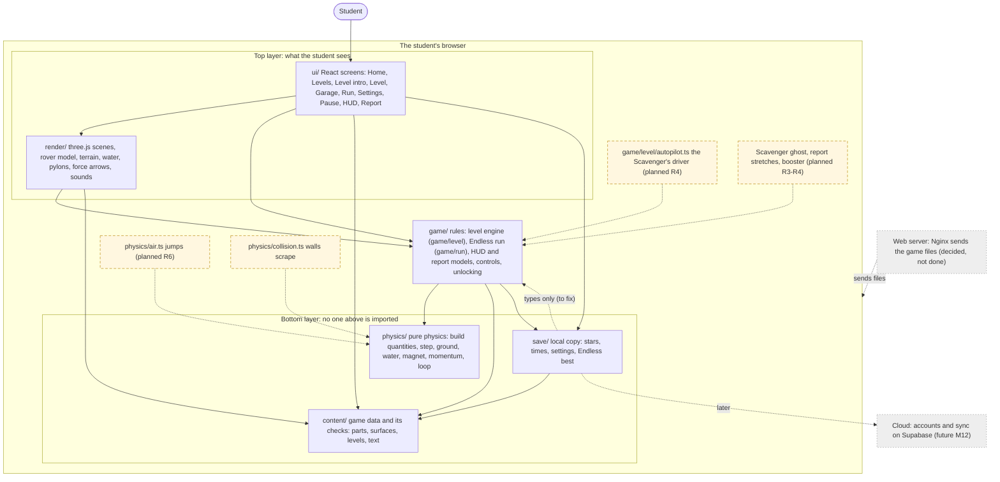

# Rovem: Architecture

**Version 2, 2026-10-21.** Replaces `Rovem_Architecture_Diagram.pdf` (Oct 12, 2026). Companion to `SRS_v0.6.md`. Rovem runs in the desktop browser from static files sent by a web server, and one physics model drives both the garage preview and the run. Progress stays on the device.

**Status words.** *Built*: in the code today (every module name below was checked against `src/` on 2026-10-21). *Planned*: decided, not built, with the session named; a planned module is drawn dashed. *Future*: a later milestone. *Superseded*: at the end.

## Change log

| What changed | Why | Source |
|---|---|---|
| Rewritten around the folders of `src/` as they are, with a Mermaid diagram and an ASCII copy, each with a "How to read it" | The PDF drew the missions-and-Knowledge design | E39, S0 |
| Screens, game flow, physics, content and local-copy blocks renamed for levels, the Scavenger and the report | Game v4 and the Showcase | E39, DECISIONS 2026-10-17, 2026-10-21 |
| Account and sync, the cloud database and the sign-in service drawn dashed as Future | Accounts are later | E39, E43 |
| Planned modules added: `physics/air.ts`, `physics/collision.ts`, the autopilot, the Scavenger ghost, report stretches, the booster, `npm run maps` and `npm run rival` | Showcase sessions R1–R8 | SHOWCASE_PLAN Parts 3–5 |
| R1 (2026-10-21) built `physics/collision.ts`, `npm run maps`, `game/level/mapSvg.ts`, `game/level/devKeys.ts` and `render/devOverlay.ts`; the stop lines are gone (a fork has a drive-through `line`) | Session R1 | SHOWCASE_PLAN §4, §5, §13 |
| Real dependency check: one two-way link between `game/` and `save/` (types), found while checking | Say what is true | S0, section 4 |

## 1 The big picture

Rovem has one rule above all: **dependencies point one way**. A lower layer never imports a higher one. `physics/` imports nothing from the rest of the app, not even React or three.js, so it runs in Node tests. React draws screens; three.js draws the 3D scene inside one React component; the game loop drives the physics. React never runs physics.

### 1.1 Mermaid diagram



**How to read it.** Each box is one part of the game. An arrow from A to B means "A uses B" and never the other way round, so you can read the picture from the top (what the student touches) down to the bottom (the pure physics and the stored data). Solid boxes exist today. **Dashed boxes with a yellow fill are planned** and carry the session that will build them. Grey dashed boxes are decided or future. A dashed arrow means "will plug into". The student never talks to the physics directly: they use the screens, the screens ask the game rules, and the game rules ask the physics.

### 1.2 The same picture in plain text

```
                        STUDENT
                           |
        +------------------+------------------+
        |   TOP LAYER (what the student sees) |
        |   ui/      React screens and HUD    |
        |   render/  three.js 3D scenes       |
        +------------------+------------------+
                           |  ui and render ask...
        +------------------v------------------+
        |   game/    the rules                |
        |     game/level/  the level engine   |
        |     game/run/    the Endless run    |
        |     [autopilot, Scavenger ghost,    |
        |      report stretches, booster]     |   <- planned R3-R4
        +--------+------------+---------+-----+
                 |            |         |
        +--------v---+  +-----v-----+ +-v--------+
        | physics/   |  | content/  | | save/    |
        | pure maths |  | game data | | local    |
        | [air.ts,   |  | and its   | | copy of  |
        | collision] |  | checks    | | progress |
        +------------+  +-----------+ +----------+
        planned: R6 (air.ts)
        
   Outside the browser:
   [ Nginx web server ] sends the files (decided, not done)
   [ Supabase cloud   ] accounts and sync (future, M12)

   Arrows always point DOWN: a lower box never uses a higher one.
```

**How to read it.** Read from the top. The student uses the two top boxes. Those ask the rules box, which turns each 1/120-second step into game events. The rules box asks three bottom boxes: the physics (the maths), the content (the numbers and level files) and the save box (what is kept on the device). Square brackets mark planned parts.

## 2 What each block does

| Block | What it does | SRS requirements | Status |
|---|---|---|---|
| Web server (Nginx) | Sends the built game files over HTTPS from a Linux server in the cloud. No game logic runs on it | SRS 2.2, NFR-1, NFR-3 | Decided, not done (M8) |
| Screens (`src/ui/`) | Home, Levels, Level intro, the Level screen, Garage, the Endless run screen, Settings, Pause, the HUD and the report | FR-1, FR-2, FR-27, FR-45, FR-48, FR-49 | Built |
| Game loop and rendering (`src/render/`) | Runs the fixed-step loop (not tied to frame rate), reads steer, throttle and brake, draws the 3D scene, plays sounds | FR-6, FR-29, NFR-2 | Built |
| Game rules (`src/game/`) | Runs a level (checkpoints and respawn, finish, stars, unlocking) and the Endless run, and turns each step into the HUD and report data | FR-5, FR-45 to FR-49, FR-51 to FR-58 | Built (level engine, run, report); Scavenger, stretches, booster Planned |
| Physics model (`src/physics/`) | Driving state, net force, acceleration, speed and distance from textbook formulas; slopes, rolling back, water, magnets, momentum events and gravity zones; supplies the garage preview | FR-3, FR-8 to FR-11, FR-28, FR-29, FR-50, NFR-4 | Built; jumps and collisions Planned |
| Content data (`src/content/`) | Parts, surfaces, level files, the endless course chunks and the level text, validated when they load | NFR-5 | Built |
| Local copy of progress (`src/save/`) | Keeps the best stars and time per level, the best Endless distance, the build and the settings in the browser's local storage | FR-24, NFR-7 | Built |
| Account and sync | Sign-up, sign-in, merge two devices | FR-25, FR-41 to FR-44 | Future (M12) |
| Cloud database, sign-in service, delete-account function | Supabase | FR-25, FR-41 | Future (M12) |
| AI helper proxy | Rephrases explanations; runs on the web server so the key never reaches the browser | SRS section 6 | Future, off every path |

## 3 Module map (checked against the code)

**`src/physics/`** (Built): `build.ts` (build quantities, power-up multiplier), `step.ts` (the fixed step, states, reverse, rolling back), `ground.ts` (R, slope pull), `water.ts` (upthrust, drag, floating), `magnet.ts` (force and its split along the gear and sideways), `momentum.ts` (`shareMomentum`, `applyImpulse`), `missions.ts` (the old mission measurements, kept for the balance report), `loop.ts` (the fixed-step loop), `collision.ts` (edges scrape: v′ = v cos α; built R1), `types.ts`.
*Planned:* `air.ts` (jumps, R6).

**`src/content/`** (Built): `parts.json`, `surfaces.json`, `constants.json`, `levels.json` (shared Game v4 values), `levels/*.json` (the seven Game v4 level files and `testCourse.json`), `levelText.json` (level cards, captions, report words), `run.json`, `runChunks.json`, `runText.json` (Endless), `garage.json`, `missions.json` and `powerUps.json` (regression only), and `schema.ts`, `types.ts`, `levelsConfig.ts`, `levelCards.ts`, `garage.ts`, `index.ts` (validation and loading).
*Planned:* level files `crash-site`, `geyser-canyon`, `crater-field` (merged), `the-crossing` (reshaped), `iron-ridge`; level data `ramps` and `stretches`; `levels.json` booster and Scavenger values.

**`src/game/`** (Built): `contracts.ts` (the types shared with the screens), `controls.ts`, `controlsText.ts`, `captionQueue.ts`, `forceLine.ts`, `forces.ts`, `levelUnlock.ts`, `pauseMenu.ts`, `resetConfirm.ts`, `geometry.ts`, `balance.ts`, `buildFromParts.ts`, `partEffects.ts`, `steeringAssist.ts` (kept, unused), `driveSession.ts`, `hud.ts`, `level.ts` (the rover's footprint for rocks, from M5a); **`game/level/`**, the level engine: `session.ts`, `world.ts`, `schema.ts`, `types.ts`, `levels.ts`, `report.ts`, `arrows.ts`, `captions.ts`, `forceLine.ts`, `keys.ts`, `devKeys.ts` (the `?dev=1` keys), `mapSvg.ts` (the picture `npm run maps` writes), `text.ts`, `index.ts`, and the test-only `testPilot.ts`, `levelPlans.ts`, `levelChecks.ts`, `testLevel.ts`; **`game/run/`**, the Endless Canyon: `runSession.ts`, `course.ts`, `rng.ts`, `drift.ts`, `feedback.ts`, `reportModel.ts`, `endlessHud.ts`, `garageView.ts`, `garageNumbers.ts`, `pausableRun.ts`, `tunnelCompare.ts`.
*Planned:* `game/level/autopilot.ts` (the Scavenger's driver, made from `testPilot.ts`; R4); the Scavenger's ghost trace, report stretches and cause events in `session.ts` and `report.ts` (R3–R4); the booster in `session.ts` and `keys.ts` (R4); Endless sections in `game/run/course.ts` (R2).

**`src/render/`** (Built): `levelScene.ts`, `devOverlay.ts` (zone outlines for `?dev=1`), `runScene.ts`, `garageScene.ts`, `driveScene.ts`, `roverModel.ts`, `roverAttitude.ts`, `terrain.ts`, `water.ts`, `track.ts`, `pylons.ts`, `landmarks.ts`, `atmosphere.ts`, `levelCamera.ts`, `forceArrows.ts`, `skidMarks.ts`, `engineSound.ts`, `effectSounds.ts`, `SceneCanvas.tsx`, `spinningCube.ts`, `levelTestKit.ts`.
*Planned:* the Scavenger's model and edge marker (R4), polygon ground blending (R2), the launch ending (R8).

**`src/ui/`** (Built): `App.tsx`, `HomeScreen.tsx`, `LevelsScreen.tsx`, `LevelIntroScreen.tsx`, `LevelScreen.tsx`, `GarageScreen.tsx`, `GaragePreview.tsx`, `RunScreen.tsx`, `SettingsScreen.tsx`, `SettingsPanel.tsx`, `PauseMenu.tsx`, `Stars.tsx`, `LevelDiagram.tsx`, `BuildScreen.tsx` and `DriveScreen.tsx` (the old test drive, kept), `screens.ts`, `levelScreenLogic.ts`, `hud/Hud.tsx`, `report/` (`ReportScreen.tsx`, `ReportCards.tsx`, `SpeedGraph.tsx`, `graph.ts`).
*Planned:* the ship-silhouette level select, the report strip with the Scavenger, Change one part (R3–R4).

**`src/save/`** (Built): `levelProgress.ts`, `settings.ts`, `demoProgress.ts`.

**`scripts/`** (Built): `balance.ts`, `maps.ts` (with `node-fs.d.ts`, the two Node file functions it uses, so no `@types/node` is needed). *Planned:* `rival` (R4).

## 4 Checked dependencies (2026-10-21)

Counting the imports between the top folders of `src/` (tests excluded): `physics/` imports **nothing** from the app (as the rule requires); `content/` imports nothing from the other folders; `game/` imports `physics/`, `content/` and `save/`; `render/` imports `game/`, `content/`, `physics/` (once, `driveScene.ts`) and `save/` (once, `runScene.ts`); `ui/` imports `game/`, `render/`, `content/` and `save/`; `save/` imports `content/` and, once, `game/contracts.ts` (a type only).

**One finding.** `game/` and `save/` point at each other: `game/levelUnlock.ts` and `game/run/reportModel.ts` use `save/`, and `save/levelProgress.ts` uses the shared types in `game/contracts.ts`. The link is small and carries only types and plain data, and nothing loops at run time, but it breaks "a lower layer never imports a higher one" for `save/`. It is recorded here, not changed (a code change). Fix when convenient by moving `StarCount` out of `game/contracts.ts` into a file `save/` owns or into `content/`.

## 5 The flow of one level

The student starts a level on the intro screen. `ui/LevelScreen.tsx` creates a session from the level file (`game/level/session.ts`) and a scene (`render/levelScene.ts`). Each frame, the loop (`physics/loop.ts`) runs as many 1/120 s steps as the frame covers. Each step: read the keys → `session` works out the ground under the rover (surface, slope, water, gravity zone, magnets) → `physics/step.ts` moves the rover → `session` checks checkpoints, samples, the finish, crashes and stuck rules → events become captions, force arrows and the HUD model (`game/contracts.ts`). At the end `game/level/report.ts` builds the report model and `save/levelProgress.ts` keeps the best stars and time. The garage preview calls the same `physics/build.ts` (FR-3).

*Planned additions to this flow:* the autopilot runs the Scavenger's whole route when the level loads (14,400 steps for 120 s, a few milliseconds) and the scene plays its ghost; the session records per stretch the time, entry and exit speed and the cause events, which `report.ts` turns into the strip and the three-line explanation (FR-55).

---

# Superseded (kept for the record)

## S1 The Draft 0.5 blocks (superseded 2026-10-17 by Game v4 and 2026-10-21)

The v0.5 diagram had 11 blocks and 1 future. Replaced or reworded:

- **Screens:** "sign-in or guest play, mission select, build rover with part effects, question and prediction dialogs, driving view showing speed and direction, results with explanation, concepts cleared" (FR-1, FR-2, FR-14 to FR-16, FR-22, FR-27, FR-32 to FR-34, FR-41).
- **Game flow and rules:** "Sets the order of an attempt (build, required questions, predict, drive, results), applies mission rules, tracks cleared questions, awards Knowledge and applies an unlock only when the balance covers its cost" (FR-5, FR-12, FR-20, FR-21, FR-26, FR-30, FR-35 to FR-40, FR-44).
- **Content data:** "Components, surfaces, terrain, missions, questions with explanations and variants, power-ups and Knowledge values… A seeding step copies the costs, rewards and order into the database tables, and an automated test checks that the two agree."
- **Local copy of progress:** "Keeps the number of answers per question, clearing times, unlocks and completed missions in the browser's local storage, in the same shape as the database tables. A completed mission is the safe point the game resumes from."
- **Account and sync** (FR-25, FR-41, FR-43, NFR-7, NFR-8): sign-up, sign-in, password reset; copy a guest's progress into a new account or ask which copy to keep; merge two devices by the higher attempt count and the earlier clearing time; send offline answers when the connection returns. *Kept as Future.*
- **Cloud database:** seven PostgreSQL tables on Supabase, row-level security, one unlock function (see `Data_Model_v2.md`, S1).
- **Sign-in service, delete-account function, AI helper proxy:** unchanged, Future.
- **"How to read it", second paragraph:** the student uses the screens, which pass actions to the game flow, "which decides what comes next: questions, prediction, the run, then results".

## S2 The Draft 0.5 requirement column

FR-1, FR-2, FR-14 to FR-16, FR-22, FR-27, FR-32 to FR-34, FR-41 on the screens block, and FR-5, FR-12, FR-20, FR-21, FR-26, FR-30, FR-35 to FR-40, FR-44 on the game-flow block. Replaced in section 2 by FR-1, FR-2, FR-27, FR-45, FR-48, FR-49 and FR-5, FR-45 to FR-49, FR-51 to FR-58 (E39).
